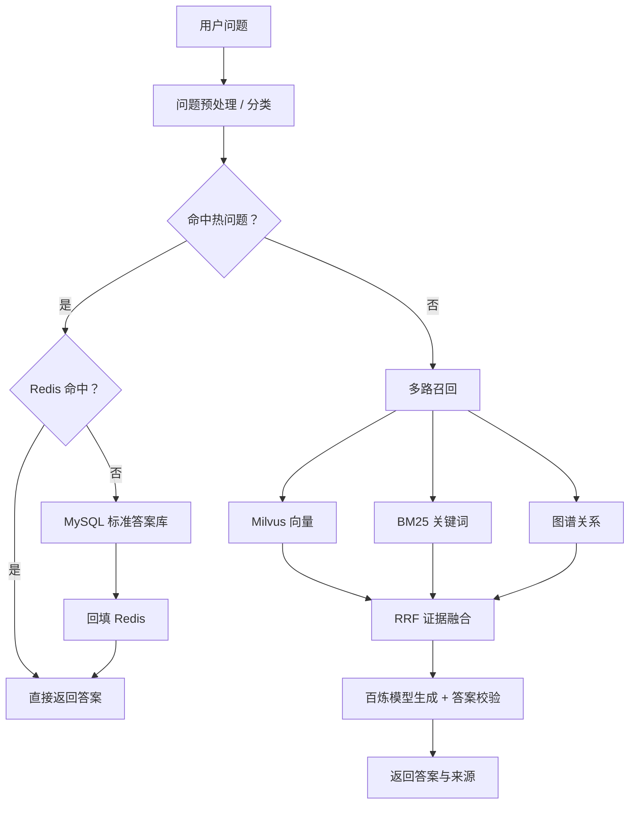

# McGraphRAG — Minecraft 知识问答系统

> 按问题类型自动选择回答路径的多通道 RAG 系统：**高频问题走 Redis + MySQL 快速通道，长尾复杂问题走多路召回 + 知识图谱通道**。

Minecraft 的知识有个特殊难点：同一个合成配方在原版、模组包、不同游戏版本里答案都不一样，而玩家提问往往只有一句话（“钻石镐怎么制作”）。单一关键词搜索覆盖不到不同表述，直接扔给大模型又答得似是而非。这个项目把问题拆成两类分别处理，并给每条结论保留可追溯的证据来源。

**技术栈**：Python · MySQL · Redis · Milvus · BM25 · BGE-M3 · RRF 融合 · 知识图谱 · 阿里云百炼（Qwen）

## 核心设计

| 设计点 | 做法 |
| --- | --- |
| 热冷分流 | 高频、答案稳定、低歧义的问题（合成、掉落、获取）命中 Redis 缓存或 MySQL 标准答案库直接返回，未命中回填缓存 |
| 多路召回 | 冷问题并行走 Milvus 稠密/稀疏向量、BM25 关键词、图谱关系、MySQL 标题精确匹配，用 RRF 融合排序 |
| 证据可追溯 | 每个实体与关系都保留原始证据和来源链接，回答里能看到检索片段 |
| 版本约束 | 知识对象带 `game_version` / `modpack_version` / `server_version` / `dimension` / `edition`，避免“看似对、其实错” |
| 降级可用 | 证据不足时明确提示而非硬答；模型或数据库不可用时回退本地检索与回答 |

## 架构



**知识图谱规模**：10 类实体（item / block / mob / biome / structure / recipe / enchantment / potion / command / mechanic），9 类关系（crafted_from / drops / spawns_in / used_for / requires / transforms_to / counters / found_in / enabled_by_version）。

## 快速开始

```bash
# 1. 依赖
python -m venv .venv && source .venv/bin/activate   # Windows: .venv\Scripts\activate
pip install -r requirements.txt

# 2. 配置
cp config.example.ini config.ini    # 填 MySQL / Redis 连接信息
cp .env.example .env                # 填百炼 API Key

# 3. 运行
python main.py
```

本地 BGE-M3 权重放在 `model/bge-m3`（体积大，已被 Git 忽略，需自行准备才能使用 Milvus 向量检索）。

### 网页问答入口

```bash
python -u qa_web.py        # 打开 http://127.0.0.1:8765
```

页面可选择 AE2 / Mekanism / Botania 或全部知识，查看答案、模型或证据模式、检索片段与来源链接。Milvus 未运行时会自动退到 BM25，页面会显示实际状态。

### 代码调用

```python
from main import IntegratedQASystem

qa = IntegratedQASystem()
result = qa.process_query("钻石镐怎么制作")
if result["success"]:
    print(result["data"]["answer"], result["source"])
qa.close()
```

### 模组知识导入

已核实的模组摘要与逐条来源在 `data/raw/mods/research_notes.json`，更新后执行：

```bash
python src/import_mod_knowledge.py
```

导入会按 `source_id` 更新本批模组资料并重建 `data/processed/rag_bm25_index.json`，与快速通道的 `mysql_qa/bm25_index.json` 分开，避免把模组文档当成 MySQL 标准答案。导入后需重启问答服务。`data/processed/mod_import_manifest.json` 记录导入数量与向量同步状态。

## 测试

```bash
python -m unittest discover tests -v
```

`tests/` 下共 25 项测试：`test_startup.py`（21 项）覆盖配置加载、依赖服务连接自检与降级路径，`test_mod_knowledge.py`（4 项）校验模组知识条目与来源字段的完整性。模型连接可用 `examples/check_llm_connection.py` 检查（不输出密钥），运行中服务的端到端问答可用 `examples/check_mod_qa.py` 验证。

## 已知限制

- 热问题判定依赖问题分类与 BM25 阈值，表述差异大时可能落到 RAG 通道（结果正确但更慢）。
- 模组知识当前只写入 BM25 索引，未同步进 Milvus 与图谱。
- 未锁定版本的 Wiki/FAQ 只作概念资料，不保证任意版本或整合包的配方一致。
- 未配置百炼密钥或调用失败时返回本地检索片段，不做生成式改写。

## 文档

- [PROJECT_COORDINATION.md](PROJECT_COORDINATION.md) — 项目统筹与任务拆解
- [代码结构.md](代码结构.md) — 模块职责与调用关系
- [README_data_processing.md](README_data_processing.md) — 数据清洗与索引构建流程

## 许可证

MIT，见 [LICENSE](LICENSE)。

---

本项目仅用于学习与技术实践，Minecraft 相关内容版权归 Mojang 所有。
